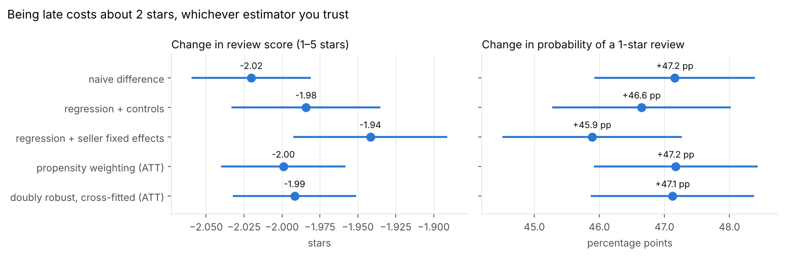
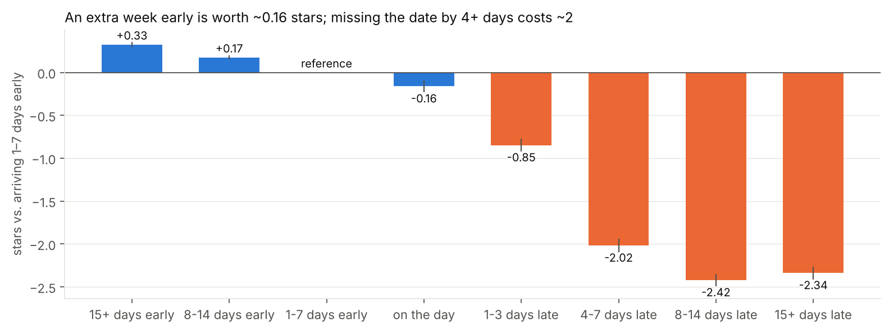
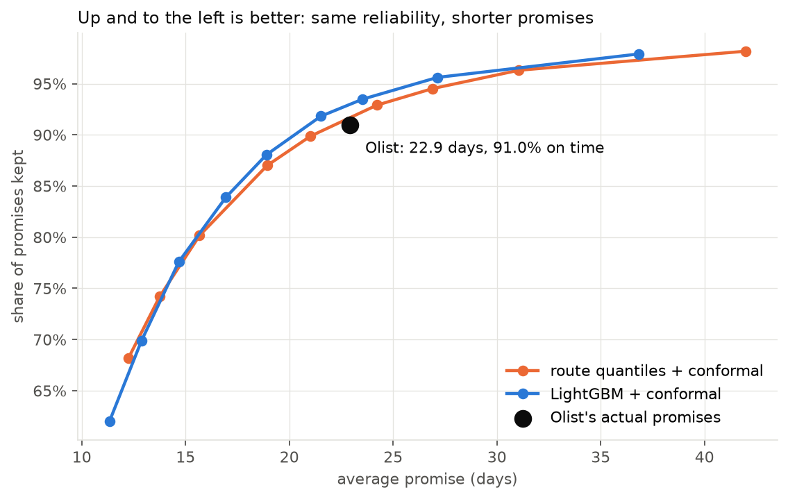

# How should a marketplace set delivery promises?

A data science project on **96k real e-commerce orders** from Olist, a Brazilian marketplace. Olist's delivery estimates are padded by about 12 days, yet 6.8% of orders still arrive late, and late orders collapse review scores (4.3 → 2.3 stars). This project measures what lateness really costs, models each order's delivery time at checkout, and designs an experiment for setting **personalised, shorter promises without more late orders**.

> **Status:** Phases 1–3 (data foundation, causal analysis, delivery-time model) complete. Phases 4–6 in progress.

## Plan

| Phase | Question | Methods |
|---|---|---|
| **1. Data foundation** ✅ | Can we trust the data? | dbt + DuckDB, 17 models, 72 data tests, 2 unit tests, SQL-vs-pandas reconciliation |
| **2. Causal analysis** ✅ | How much does lateness *cause* bad reviews and lost customers? | Regression with controls and seller fixed effects, propensity weighting, cross-fitted doubly robust estimation, dose-response, placebo and E-value |
| **3. Prediction** ✅ | How long will *this* order take, known at checkout? | Point-in-time feature mart, LightGBM quantile regression, out-of-time test, split-conformal calibration |
| 4. Trade-off | How much shorter could promises be at today's late rate? | Promise-length vs. late-rate frontier |
| 5. Experiment design | How would we test personalised promises safely? | Metrics, guardrails, power analysis |
| 6. Business impact | What should Olist do? | Memo + dashboard |

## Phase 2 results ([notebook](analysis/02_late_delivery_effect.ipynb) · [write-up](docs/PHASE2_RESULTS.md))



- **A missed promise costs 1.99 stars** (doubly robust ATT, 95% CI −2.03 to −1.95) and adds **47 pp** to the chance of a 1-star review. Five estimators agree within 0.08 stars, including a within-seller comparison.
- **The penalty is asymmetric:** each extra week early is worth about +0.16 stars, while 4+ days late costs 2.0–2.4.
- **Retention:** a late first order lowers the 180-day repeat rate by about 15% (0.3 pp on a 2% base), but the interval includes zero. The data can only detect drops of about 32% or more, so this is a question for an experiment (Phase 5).
- **Robustness:** the effect survives dropping congested months, month × state fixed effects and simple single-item orders. A placebo with shuffled lateness gives zero.



## Phase 3 results ([notebook](analysis/03_delivery_time_model.ipynb) · [write-up](docs/PHASE3_RESULTS.md))



- **Same reliability, shorter promises:** at Olist's own on-time rate (91.0%, Feb–Aug 2018), calibrated model promises average **20.9 days vs. 22.9 (−9%)**. A per-route lookup table gets only 0.75 days of that.
- **Honest out of time:** trained on 2017 and tested on Feb–Aug 2018, P90/P95 promises were kept 91.8% and 95.7% of the time. Orders that never arrived count as misses.
- **No leakage, by construction and by test:** seller track record and network congestion are computed point-in-time in dbt and guarded by a unit test and two singular tests.
- **Disruptions are the limit:** in the Feb–Mar 2018 carrier disruption the model kept 83–85% of promises against Olist's 80–85%. The fix is operational: weekly recalibration and live on-time monitoring.

## Early findings (from [docs/DATA_PROFILE.md](docs/DATA_PROFILE.md))
- **Padded promises:** the median promise is 24 days for a 10-day median delivery.
- **Lateness wrecks reviews:** the 1-star share rises from ~6% to ~68% once an order is 8+ days late.
- **Early barely helps (raw):** 15+ days early scores only 0.1 stars more than 1–7 days early. After adjustment it is +0.33 (Phase 2), still small next to the late penalty.
- **Measurement trap:** 73% of late orders were reviewed before they arrived.
- **Split checkouts inflate retention by ~60%:** grouping same-day orders into one purchase drops the 180-day repeat rate from 3.2% to 2.0%.

## Data model

```
raw CSVs (9 tables) ─► staging (typed, deduplicated, geo-cleaned)
                     ─► intermediate (baskets, payments, purchase sessions)
                     ─► marts: fct_orders (1 row/order: promise, outcome, review, checkout features)
                               fct_customer_first_purchase (retention cohort)
                               fct_order_features (point-in-time model features + label)
```

Key modelling decisions:
- **Purchase sessions.** Olist creates one order per seller, so same-day orders by one person are one checkout, not repeat purchases.
- **Eligibility flag.** Orders with impossible timelines (carrier pickup before purchase, etc.) stay in the table but are excluded from analysis via `is_analysis_eligible`.
- **One review per order:** the latest survey answer.
- **Distance:** great-circle km between the seller's and customer's zip-code centroids, after dropping geocodes outside Brazil.
- **Point-in-time features.** A seller's track record only counts orders delivered before the checkout timestamp; congestion features only use earlier days. Both are tested for leakage.

## Quality checks
- **dbt data tests** on keys, ranges and relationships, plus invariants (the late flag matches the dates, no same-day "repeat" purchases, a distance sanity check).
- **dbt unit test** for the purchase-session logic.
- **Reconciliation:** `scripts/reconcile.py` recomputes the headline metrics from the raw CSVs with pandas and checks the SQL warehouse matches exactly.
- **CI** builds the whole warehouse from a synthetic dataset with the identical schema on every push. The real data isn't committed.

## Run it

```bash
python -m venv .venv && source .venv/bin/activate
make setup
# download the data into data/raw (see data/README.md), then:
make build        # dbt: build + test the warehouse
make reconcile    # SQL vs. pandas
make test         # causal estimators and promise-model helpers on simulated data
make notebooks    # re-run the Phase 2 and 3 analyses (~4 min)
```

## Data
[Brazilian E-Commerce Public Dataset by Olist](https://www.kaggle.com/datasets/olistbr/brazilian-ecommerce) (CC BY-NC-SA 4.0): real, anonymised orders from 2016–2018.
